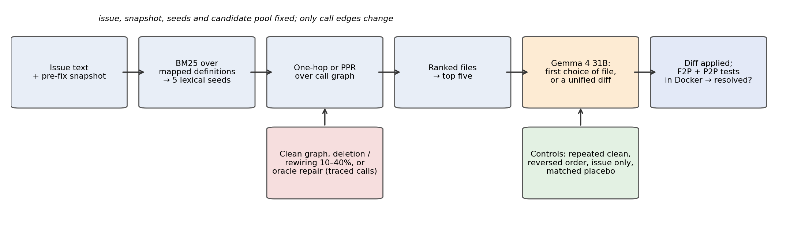
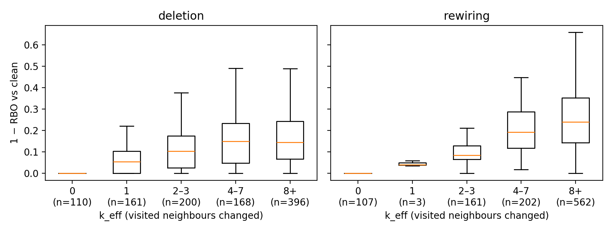

# Same Score, Different Context: Call-Graph Errors, Retrieval Stability, and What Gemma 4 Does With Them

## Abstract

Static Python call graphs miss edges, and graph-guided retrieval hands those errors straight to coding agents. We follow them from graph to patch on 115 tasks from the Gemma 4 Developer Agent Competition, corrupting 10–40% of call edges and, separately, tracing the calls each task's tests execute. The supplied graphs miss 71% of executed call edges. Corruption barely moves Recall@5 (personalized PageRank loses 0.042 under 40% rewiring), yet it changes the context a lot: at 40% rewiring, top-five membership changes in about nine of ten cells, for a one-hop and a PageRank retriever alike. Gemma 4 reacts to these changes, but no more often than to matched random ones. We found no measurable effect on patches, though with only 6.5% of tasks resolved the readout had little power. We release two pre-registrations with a deviations log, a call tracer, and a test harness that resolves all 108 evaluable reference patches.

## 1 Introduction

Graph-guided localizers help coding agents find code an issue never mentions [1, 5], but static Python call graphs are incomplete: PyCG reports about 99% precision and only about 70% recall [6], and agents in this competition inherit those gaps. What does a wrong graph do downstream?

The usual robustness check is Recall@5, the share of patch-touched files among the top five. With one or two gold files per task, it can stay put while the rest of the top five changes. But an agent never sees the score; it sees the files and writes a patch. So we follow the error along that chain, asking how much localization accuracy changes (**RQ1**), how much the ranked context changes (**RQ2**), whether Gemma 4 picks a different file when the top five changes but Recall@5 does not, more often than after a matched random change (**RQ3**), and whether the patch still passes the tests (**RQ4**).

**Key findings.**

- Accuracy barely changes, except for PPR under 40% rewiring.
- The context changes often; Gemma 4 follows it no more than it follows random changes.
- Patch outcomes do not change measurably, but the patch readout has little power.

Our contributions are a run-time measure of what the competition's graphs miss, an edge-only corruption protocol with verified provenance, and two pre-registered readouts that keep forced and unforced changes apart.

## 2 Related work

LocAgent [1] lets LLM agents walk a repository graph, and CoSIL [5] searches call graphs; both get worse without the graph, but those ablations remove all of it; we corrupt or repair only part. RepoGraph [3], GREPO [2] and Agent Retrieval Bench [4] build or benchmark graph-based localization. Agentless [14] splits localization from repair, as our two readouts do, and our patch tests follow SWE-bench [13].

PyCG [6] measured recall against hand-built call graphs; we measure it against calls the tests actually make. Order Matters [7] found LLM fault localization sensitive to candidate order on long lists, less on short ones, hence our order-only controls. In retrieval-augmented generation, highly ranked irrelevant passages hurt while random ones can help [12], so we count gold choices lost and gained rather than flips alone.

## 3 Data and provenance

**Competition tasks.** The public development set [10] has 129 tasks from FastAPI, Rich, Requests and HTTPX, with call graphs from an unnamed extractor. We use 115 of them: 24 held out and committed before they ran, and 91 added after we had seen those results and run twice, with identical substantive predictions. Snapshot tree hashes match the upstream base commits, and candidates are pre-fix definitions linked to graph IDs by qualified names or unique aliases. Gold files are those the reference patch changes; unretrievable ones stay in the denominators. Predictions are saved before labels are loaded.

**Post-cutoff tasks.** To limit memorization, the second registration added FastAPI, Rich and Requests issues opened and fixed after 1 March 2025, past the model's January 2025 training cutoff [11]. All 23 qualifying tasks turned out to be competition tasks with the same pull request and base commit (the other 18 candidates failed selection). Re-testing them would reuse cells H2 and H3 already used, so we report H4 and H8 as not testable. Even so, 87 of the 115 competition tasks postdate that date; §5.3 splits by it.

## 4 Methods

### 4.1 Retrievers

Both retrievers start from the same five BM25 seeds (k1 = 1.2, b = 0.75, issue text as query) and share candidates and cutoffs.

- **One-hop:** each seed keeps 15% of its normalized BM25 mass and shares the rest equally among its outgoing neighbours, with at most 100 visits across all seeds.
- **Personalized PageRank (PPR):** restart 0.15 to the seed distribution, on the subgraph of mapped candidates, iterated to convergence.

A file takes its best node's rank; unvisited candidates follow in BM25 order.

### 4.2 Graph conditions

**Synthetic.** Deletion removes ⌊f·|E|⌋ seeded edges, and rewiring moves as many edge targets to random endpoints, with no self-loops or duplicates. We use fractions of 10%, 20% and 40% and seeds 13, 37 and 101. For one-hop, the delivered dose k counts corrupted edges among the seeds' out-edges, and k_eff counts neighbours that differ between the clean and corrupted visited sets. All 214 cells with k = 0 reproduce the clean ranking exactly.

**Traced.** We run each task's fail-to-pass and pass-to-pass tests under a call tracer, in Docker, offline, with dependencies resolved as of the task's creation date, and map each executed caller–callee pair to graph IDs. The executed edges missing from the supplied graph give its run-time miss rate, and adding them back gives a repaired graph. Because the tests come from the reference fix, this is oracle repair: a bound on what better edges could do, not something an agent could run.

We measure the change in Recall@5 from clean, whether top-five membership changed, and 1 − extrapolated rank-biased overlap (RBO, persistence 0.9) [8].

### 4.3 Readouts

**Decision.** gemma-4-31b-it-qat-w4a16-ct [9] (vLLM 0.19.1, four L4 GPUs, thinking off, greedy) sees the issue and the top five files, each shown as path and definitions (2,500 tokens), and names up to three of them to modify, or none. It sees the clean context (C0), three clean repeats (C0r, the engine floor), the clean files reversed (CR), the issue alone (CN), and every 40% one-hop cell whose ordered top five differs from clean. For each cell with unchanged Recall@5 that still shows C0's choice, a matched placebo replaces each incoming file with a seeded non-gold file from clean ranks 6–20. Invalid replies are re-asked once, then excluded and counted.

**Patch.** The same model writes a unified diff from the issue and the top five files, each cut to 4,800 tokens. It does so for C0, two engine-floor repeats of C0 at new batch positions, the decision readout's 608 corrupted cells and 421 placebos, and the repaired top five where it differs from clean (28 tasks). We apply the diff to the pre-fix tree, add the reference test changes and run the fail-to-pass and pass-to-pass tests in Docker; a cell resolves only if all pass. The test sets come from running the tests before and after the reference fix. Seven tasks were excluded before any output was read (three lack a fail-to-pass test, and four base runs produced no outcomes). On the other 108, every reference patch resolves when passed through the same extraction and evaluation.

### 4.4 Hypotheses and statistics

The first registration (commit b1044d0, before the main run) fixed three hypotheses on the competition tasks. **H1:** order-only cells flip within ±10 points of CR (90% interval). **H2:** cells with changed membership but unchanged Recall@5 flip more often than C0r. **H3:** those cells also flip more often than their matched placebos.

The second (commit 4500dc4, before any new run) fixed:

- **H5:** in H2's cells, the patch resolve rate stays within ±5 points of clean (90% interval).
- **H6:** cells where Recall@5 drops resolve less often than clean.
- **H7:** the repaired graph gives higher one-hop Recall@5 than the supplied graph.
- **H4, H8:** H2, H3 and a frozen flip-risk score on post-cutoff tasks (not testable, §3).

We average rates within each task and then across tasks, and flip tests use only cells that still show C0's choice; each hypothesis needs five eligible tasks. Intervals come from 10,000 paired bootstrap resamples of tasks. One-sided tests use bootstrap p-values with Holm adjustment within each registration, so the second family, without H4 and H8, contains H6 and H7. A failed H3 reads as placebo-heavier if its 95% interval lies below zero, generic if its 90% interval lies within ±10 points, and inconclusive otherwise. Everything else is exploratory; every departure from the registrations, with its reason and effect, is in `deviations.md`.

## 5 Results

### 5.1 Accuracy holds; the context does not (RQ1, RQ2)

Clean one-hop Recall@5 is 0.3699 (BM25: 0.3352). No interval for its mean change excludes zero at any fraction, even though top-five membership changes in 446 of 1,035 deletion cells and 726 of 1,035 rewiring cells. PPR's context changes about as often, and 40% rewiring lowers its Recall@5 by 0.042, the only interval in Table 1 that excludes zero. Mean 1 − RBO rises with k_eff (Figure 1), faster under rewiring.

**Table 1.** Change from the clean graph at 40% corruption, competition tasks (345 cells per row).

| Retriever | Intervention | Mean Δ Recall@5 [95% CI] | Membership changed | Mean 1 − RBO [95% CI] |
| --- | --- | ---: | ---: | ---: |
| One-hop | deletion | −0.0029 [−0.0345, +0.0311] | 219 | 0.192 [0.174, 0.209] |
| One-hop | rewiring | −0.0309 [−0.0714, +0.0095] | 312 | 0.302 [0.283, 0.321] |
| PPR | deletion | −0.0072 [−0.0330, +0.0215] | 234 | 0.254 [0.239, 0.268] |
| PPR | rewiring | −0.0417 [−0.0754, −0.0119] | 300 | 0.376 [0.354, 0.399] |

Small errors are enough: 1% one-hop rewiring changes membership in 24 of 345 cells and Recall@5 in none, and 5% in 95 and 6.

### 5.2 What the supplied graphs miss

On the 106 tasks with traced calls, the tests execute 14,921 distinct call edges, and the supplied graphs miss 71% of them (median per task 49%). The largest group of misses (33%) is method calls resolved at run time. Calls to special methods such as constructors and operators make up 31%, and calls to decorated definitions such as properties 25%. Oracle repair raises one-hop Recall@5 by +0.0236 [+0.0000, +0.0566] (p = 0.044), which is not enough for H7, since Holm adjustment needs p ≤ 0.025. It also changes top-five membership in 19 of 115 tasks.

### 5.3 Gemma 4 follows the context, but generically (RQ3)

H1 is not established. Order-only cells flip 3.5 points less often than CR, but the 90% interval, [−11.8, +4.9], crosses −10. H2 holds: where membership changes but Recall@5 does not, Gemma 4 flips 10.3 points more often than the engine floor (adjusted p < 0.001). H3 fails, and under the registered rule it reads as generic: −1.3 points against the placebo (95% [−5.7, +3.0]), or +0.9 [−3.9, +6.2] if we drop tasks whose issue-only choice is gold.

The flips that Recall@5 misses rarely involve gold (Table 2). H2's 421 cells lose a gold first choice four times and gain two. Most gold losses (33 of 42) are forced, because the gold choice has left the top five. The other nine fall in order-only or H2 cells, where Recall@5 cannot register them. The net change in gold first choices is −0.032 [−0.070, +0.006] per task (sign-flip p = 0.12).

**Table 2.** First-choice flips at 40% corruption, averaged per task; gold lost / gained count cells.

| Condition | Cells / tasks | Flip rate [95% CI] | Gold lost / gained |
| --- | ---: | ---: | ---: |
| Engine floor (C0r) | 345 / 115 | 0.6% [0.0, 1.7] | 0 / 0 |
| Reversed order (CR) | 115 / 115 | 18.3% [11.3, 26.1] | 3 / 1 |
| Order-only (H1) | 77 / 48 | 11.1% [3.5, 20.1] | 5 / 2 |
| Choice forced out | 78 / 35 | forced | 33 / 3 |
| Choice shown, Recall@5 changed | 32 / 16 | 53.1% [31.2, 75.1] | 0 / 14 |
| Choice shown, Recall@5 unchanged (H2) | 421 / 109 | 10.3% [6.3, 15.1] | 4 / 2 |
| Matched placebo (H3) | 421 / 109 | 11.7% [7.1, 16.7] | 2 / 1 |

**By creation date (exploratory).** On the 28 tasks created before 1 March 2025, H2 is +14.9 [+5.6, +25.9] points and H3 +6.4 [+0.6, +15.3] (27 tasks); on the 87 created after, +8.8 [+4.7, +13.7] and −3.9 [−9.0, +1.0] (82 tasks). Only the older tasks show corrupted changes moving the model more than random ones, and it is one uncorrected contrast: a lead, not a finding.

### 5.4 From decisions to patches (RQ4)

With the clean context, Gemma 4 resolves 6.5% of the 108 evaluable tasks, and only 52.8% of its diffs apply. The engine-floor repeats agree with clean in 97.7% of runs; three of 1,802 runs crashed (unresolved). Where membership changes but Recall@5 does not, the resolve rate changes by −0.2 points (90% [−2.5, +2.3]; 102 tasks), so H5 holds, and the matched placebo gives −1.1 [−4.1, +1.2]. The interval is narrow mostly because 91 of those tasks never resolve, either cleanly or in any such cell. Where Recall@5 drops (40 cells, 18 tasks), no task resolves in either context, so H6 is not established (p = 1). On the 28 tasks whose ordered top five changes under oracle repair, the resolve rate changes by +3.6 points [−7.1, +17.9].

### 5.5 Predicting flips and reducing churn

A logistic model of the 530 cells that still show C0's choice (in-sample AUC 0.645; task-clustered intervals) finds one feature whose interval excludes zero: the lower C0's choice sits in the corrupted list, the more likely a flip. Its held-out test (H8) needed post-cutoff tasks. Averaging one-hop scores over ten graphs with 20% edge dropout does not reduce churn either (91% of 40%-rewiring cells change membership, against 90% without), costs 14.9× as much and lowers Recall@5 by 0.030.

## 6 Limitations

**Limits of the evidence.**

- We cover three Python repositories, one edge type and one model family. Without fresh post-cutoff tasks, memorization is only partly addressed.
- Traced calls cover only executed code, so the repaired graph is incomplete.
- The patch readout is single-turn and near its floor, and about half its diffs fail to apply under the registered format.
- File-level gold labels only approximate the context an agent needs.

**Process deviations** (all in `deviations.md`). A container memory cap was added partway through the trace run, and three tasks ran under it. H7 excludes tasks without fail-to-pass tests. We re-derived 35 test sets (four changed) after a crashed base run had been read as outcomes, before any patch was evaluated. The agentic retriever, the agent readout and six exploratory settings were not run, the settings for lack of GPU quota.

## 7 Reproducibility and conclusion

The repository (Apache 2.0) holds the code, configurations, task lists, prompts, both registrations, the deviations log, rankings, decision-readout outputs and notebooks, with unit tests for RBO, flip coding, the bootstrap, the tracer and the harness. The competition rules do not allow us to release the corpus or its labelled derivatives (gold files, test sets, per-task outcomes, patches over its code), so the scripts regenerate them from a participant's copy.

Call-graph errors barely move accuracy, but they often change the context. Gemma 4 follows those changes no more than it follows random ones, and patch outcomes do not change measurably, though at a 6.5% resolve rate they could hardly have shown harm. For robustness reports on graph-guided agents, we recommend:

- top-five membership change and mean 1 − RBO alongside accuracy;
- unforced decision flips measured against a matched placebo, not raw flip rates;
- patch-level checks only with a model and harness that resolve enough tasks for harm to show.

## References

[1] Chen et al. LocAgent: Graph-Guided LLM Agents for Code Localization. arXiv:2503.09089.

[2] Wang et al. GREPO: A Benchmark for Graph Neural Networks on Repository-Level Bug Localization. arXiv:2602.13921.

[3] Ouyang et al. RepoGraph: Enhancing AI Software Engineering with Repository-level Code Graph. ICLR 2025. arXiv:2410.14684.

[4] Qin and Xie. Agent Retrieval Bench: Evaluating Repository Context Retrieval for Coding Agents. arXiv:2607.24882.

[5] Jiang et al. CoSIL: Issue Localization via LLM-Driven Code Graph Searching. ASE 2025. arXiv:2503.22424.

[6] Salis et al. PyCG: Practical Call Graph Generation in Python. ICSE 2021. arXiv:2103.00587.

[7] Rafi et al. Order Matters! An Empirical Study on Large Language Models' Input Order Bias in Software Fault Localization. ICSE 2026. arXiv:2412.18750.

[8] Webber, Moffat and Zobel. A Similarity Measure for Indefinite Rankings. ACM TOIS 28(4), 2010.

[9] Google DeepMind. Gemma 4 model card. 2026. https://ai.google.dev/gemma/docs/core/model_card_4

[10] Google DeepMind. Gemma 4 Developer Agent Competition: dataset description. Kaggle, 2026. https://www.kaggle.com/competitions/gemma-4-developer-agent/data

[11] NVIDIA. Gemma 4 31B IT model card. 2026. https://docs.api.nvidia.com/nim/reference/google-gemma-4-31b-it

[12] Cuconasu et al. The Power of Noise: Redefining Retrieval for RAG Systems. SIGIR 2024. arXiv:2401.14887.

[13] Jimenez et al. SWE-bench: Can Language Models Resolve Real-World GitHub Issues? ICLR 2024. arXiv:2310.06770.

[14] Xia et al. Agentless: Demystifying LLM-based Software Engineering Agents. arXiv:2407.01489.
